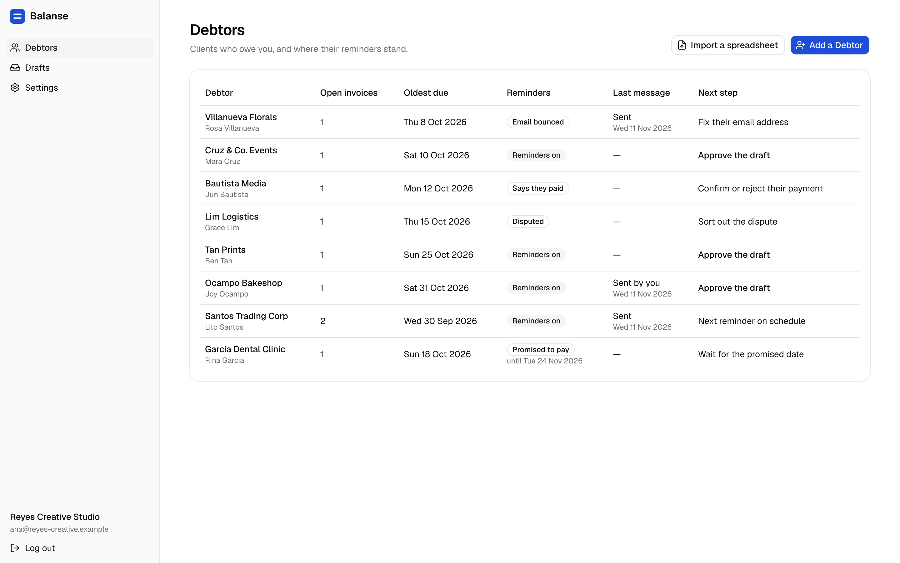
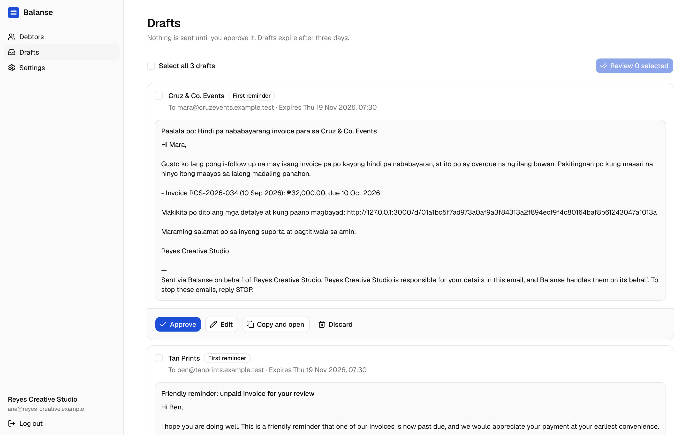
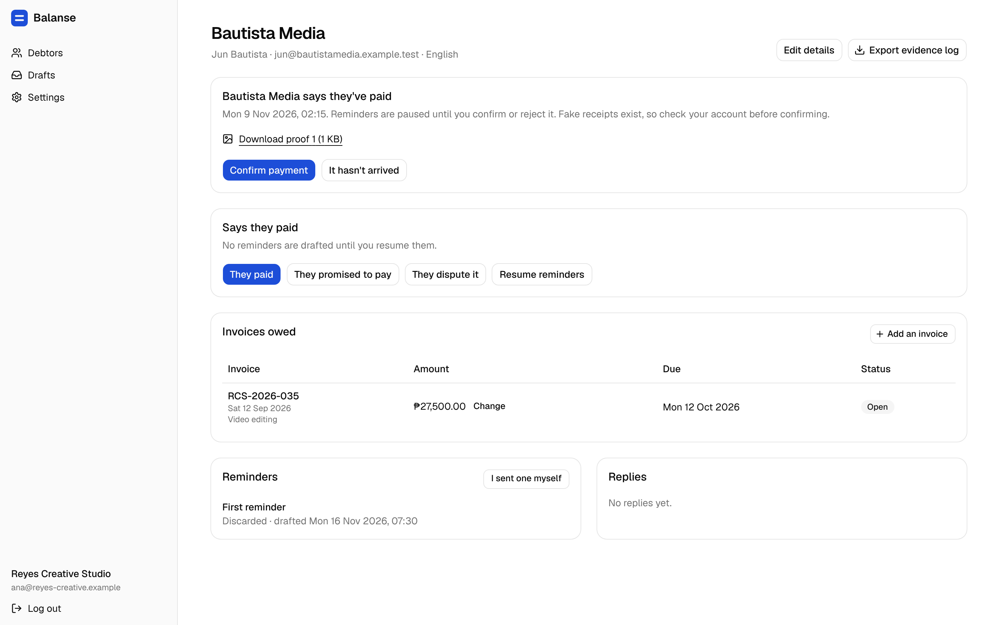
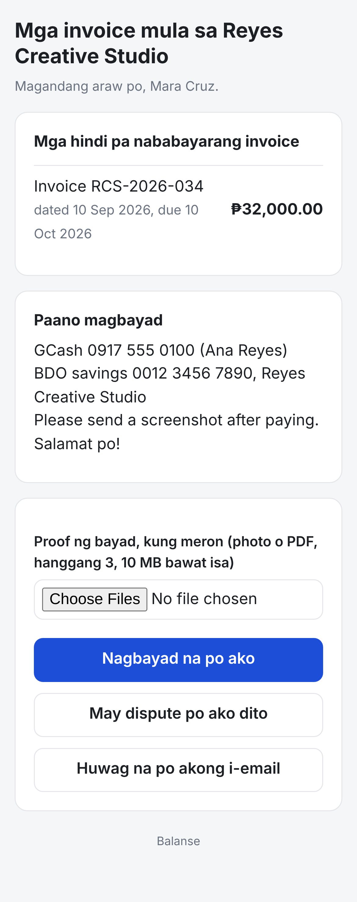
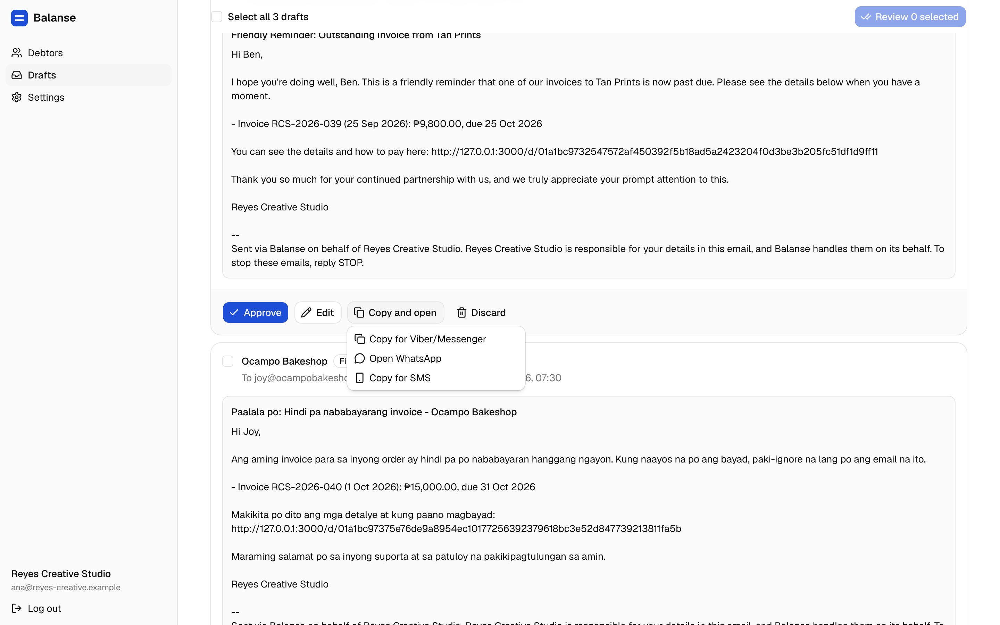

# Balanse

*Filipino for "balance"*

**Polite payment follow-up for Philippine small businesses.**

Small businesses wait weeks to be paid, and chasing clients is awkward: one Viber message too many and the relationship suffers. Balanse does the following up, politely:

- a **list of who owes you**, typed in or imported from a spreadsheet, with each amount kept exactly as you typed it;
- **reminders in Taglish or English** on a gentle schedule, worded by AI or by fixed templates, and **sent only after you approve each one** exactly as it will go out;
- a **private page for each client**, opened from the reminder on their phone with no app and no login, showing what's owed and your own payment instructions, with **"I've paid"** (with a screenshot), **"I dispute this"** and **"Stop emailing me"**;
- reminders that **stop** as soon as the client replies, pays, disputes or asks to stop, and never more than one message in three days;
- **copy and open** for Viber, Messenger, WhatsApp and SMS, with "I sent one myself" so your own messages count too;
- a **dashboard** of who needs you first, then the oldest overdue;
- an **evidence log** of every message and answer for each client, exported as a CSV file;
- **bounces** stop reminders to an address that doesn't work until you change it.



**See it working:** a [two-minute walkthrough video](docs/showcase/walkthrough.mp4) and more screenshots in [`docs/showcase/`](docs/showcase/), all of a made-up demo business.

| | |
|---|---|
|  |  |
| Drafts wait for your approval | A client says they've paid; you confirm |
|  |  |
| The client's page, on their phone | Copy and open in your own chat |

Balanse never touches the money, never contacts anyone but the client's own Contact, and never threatens or shames anyone. It keeps no books: no totals across clients, no aging reports, and nothing titled an invoice, receipt or statement of account (`docs/research/legal-limits.md`, R1–R18). It only follows up.

## Where the data comes from

- **In the demo:** a made-up design studio chasing seven made-up clients, set up through Balanse's own sign-up and spreadsheet import, from a made-up file of unpaid invoices (`web/showcase/global-setup.ts`). Every name, amount and `.example.test` address is invented.
- **In a real business:** the owner types each Debtor and invoice in, or imports a CSV or Excel spreadsheet of who owes them, exported from their own invoicing or accounting tool or kept by hand; the import lists any row it refuses and why. The client's answers ("I've paid" with a screenshot, disputes) come from the client's own page.
- Nothing in this repository is real customer data.

## Status

| Stage | Status |
|---|---|
| Research, brief, spec (38 acceptance criteria), architecture | Done |
| **M1** Sign-up and login, Debtors and invoices, the schedule, Drafts, approval, sending once in sending hours, replies | Done |
| **M2** The client's page: "I've paid" with proof, "I dispute this", "Stop"; payment instructions | Done |
| **M3** AI-worded reminders with template fallback, and a guard against threats and shaming | Done; AI wording turns on with an API key |
| **M4** Spreadsheet import, the dashboard, copy and open | Done |
| **M5** Bounces, the evidence log, downloading your data, closing the account, retention | Done |
| **M6** Deployment at `balanseapp.com` | Waits for the domain |
| 3–5 free pilots | After deployment |

Every acceptance criterion in `docs/product/spec.md` has a test, and they pass. Where things stand and what's next: [ROADMAP.md](ROADMAP.md).

## How it's built

One Rust program on a reusable engine:

- **[Nudgewright](https://github.com/Enriquez-Johnmark/nudgewright)** is the engine, shared with [Kompleto](https://github.com/Enriquez-Johnmark/kompleto): the approval outbox, sending each email exactly once, pre-send checks, replies and delivery events, accounts and logins, spreadsheet reading, encrypted files and virus scanning, the AI client, the audit and cost logs. Balanse uses a pinned release.
- **`src/balanse/`** is the product: Debtors and Debts, the reminder schedule, the wording and its guard, the client's page, claims and proofs, the evidence log, retention and the web API.

Safety rules live in code, not prompts: nothing is sent without an approval that matches the exact text, every reminder is checked again just before sending, each email is sent at most once, even after a crash, and the frequency cap and sending hours (weekdays, 08:00–20:00 Manila time) are enforced by the program.

| Part | Technology |
|---|---|
| Backend | Rust, axum, sqlx, PostgreSQL 17 |
| Owner's pages | React with Vite, TypeScript, shadcn/ui, Tailwind, over a JSON API (`docs/frontend.md`) |
| Client's page | Server-rendered HTML, built to load fast on cheap phones |
| Email | Resend (sending and delivery events), Mailpit in development |
| AI | Claude via API key, for wording reminders only; fixed templates when no key is set |

## Run it locally

You need Docker, Rust (the version is pinned in `rust-toolchain.toml`), Node 22 and pnpm (`corepack enable`).

```sh
cp .env.example .env          # once
docker compose up -d          # Postgres 17 and Mailpit
pnpm --dir web install
pnpm --dir web build          # the React app, served by the Rust server
cargo run -- serve            # http://127.0.0.1:3000
```

Every email lands in Mailpit at http://localhost:8025 in development; nothing leaves your machine. To scan proof files for viruses as production does, run `docker compose --profile scan up -d` as well and set `CLAMD_ADDR=127.0.0.1:3310` in `.env`.

**Try the whole loop:**

1. Open http://127.0.0.1:3000/signup and request an account. Approve it with `cargo run -- signups`, then `cargo run -- approve-signup <id>`; the welcome email with your login link is in Mailpit.
2. Add a Debtor and an invoice whose due date has passed, or choose "Import a spreadsheet" and use the template.
3. Draft the reminders due on a weekday: `cargo run -- dev-schedule --date YYYY-MM-DD`.
4. Approve them on the Drafts page. They're sent on a weekday between 08:00 and 20:00 Manila time and appear in Mailpit.
5. Open the link in a reminder: that's the client's page. Press "I've paid" with a photo, then confirm the claim on the Debtor's page in the app.
6. Try "Copy and open" on a draft, "Export evidence log" and "Edit details" on a Debtor, and "Download all your data" under Settings.
7. Optional: put an `ANTHROPIC_API_KEY` in `.env` (an API key, never a Claude subscription) and draft again: the model writes the wording, Balanse inserts the facts, and anything it gets wrong falls back to the template.

**Working on the React app:** run `pnpm --dir web dev` as well and open http://localhost:5173, which reloads as you edit and passes `/api` to the Rust server. Set `PUBLIC_BASE_URL=http://localhost:5173` in `.env` so login links open there.

Other commands:

| Command | What it does |
|---|---|
| `cargo run -- migrate` | Applies the database migrations (`serve` does too) |
| `cargo run -- signups` | Account requests from the sign-up page; `approve-signup ID` opens the business and emails its owner a welcome login link, `decline-signup ID` deletes it |
| `cargo run -- dev-schedule --date 2026-11-09` | Creates the reminder Drafts due on that date, to try the loop before real dates come round |
| `cargo run -- schedule` | Runs the scheduler once, as `serve` does every hour |
| `cargo run -- outbox-drain` | Sends what is approved and due, once |

Replies are taken in at `/hooks/inbound-email` when `INBOUND_SECRET` is set, and bounces and complaints at `/hooks/resend` when `RESEND_WEBHOOK_SECRET` is set.

## Tests and checks

```sh
cargo fmt --check
cargo clippy --all-targets --all-features --locked -- -D warnings
cargo test --all-features --locked
```

`--all-features` includes the crash test that proves an email is never sent twice. `cargo test` also writes the API's TypeScript types into `web/src/api/generated/`; commit them. After changing SQL, run `cargo sqlx prepare -- --all-targets --all-features` and commit `.sqlx/`, because CI compiles without a database.

The React app's checks:

```sh
pnpm --dir web lint
pnpm --dir web typecheck
pnpm --dir web test
pnpm --dir web build
pnpm --dir web e2e            # browser tests, against a running `cargo run -- serve`
pnpm --dir web showcase       # remakes docs/showcase/ (docs/showcase/README.md)
```

## Project layout

```
src/balanse/      the product, including its JSON API (src/balanse/web/api/)
web/              the React app; web/e2e/ holds the browser tests, web/showcase/ the showcase scripts
templates/        the client's server-rendered page
migrations/       database migrations
tests/            Rust tests; each acceptance criterion's test starts with its ID
docs/             brief, spec, architecture, decisions, research, showcase
.claude/skills/   the coding skills Claude follows (Rust, React, shadcn)
```

## Documents

| Read | For |
|---|---|
| `docs/product/brief.md` | What Balanse is and for whom |
| `docs/product/spec.md` | The spec and its 38 acceptance criteria |
| `docs/research/legal-limits.md` | The legal limits R1–R18 that the code enforces |
| `docs/architecture.md` | How it's built, and the build order |
| `docs/frontend.md` | React conventions and folder layout |
| `docs/decisions.md` | Every decision the owner made, dated |
| `ROADMAP.md` | Where things stand and what's next |
| `AGENTS.md` | The rules for working on this repository |
| `GLOSSARY.md` | The project's words: Business, Owner, Debtor, Contact, Debt, Claim… |

## Licence

All rights reserved ([LICENSE](LICENSE)). The source is published to be read, not reused: copying, running or hosting it needs the author's written permission. The engine, [Nudgewright](https://github.com/Enriquez-Johnmark/nudgewright), is open source under AGPL-3.0-only.
